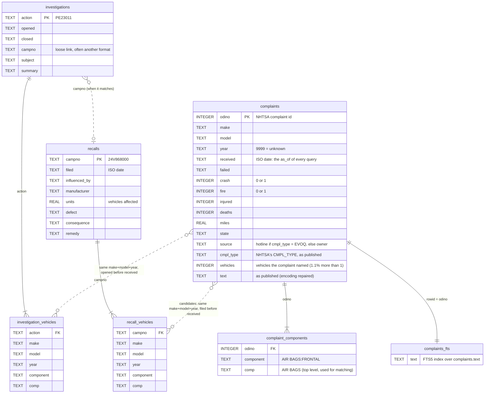
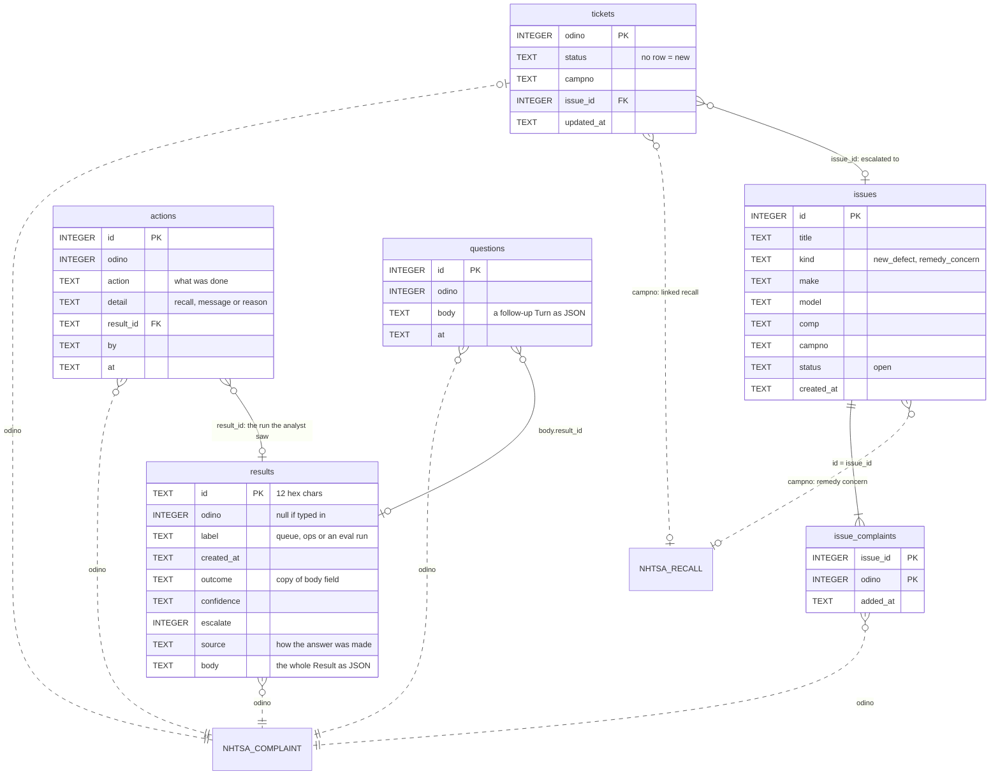
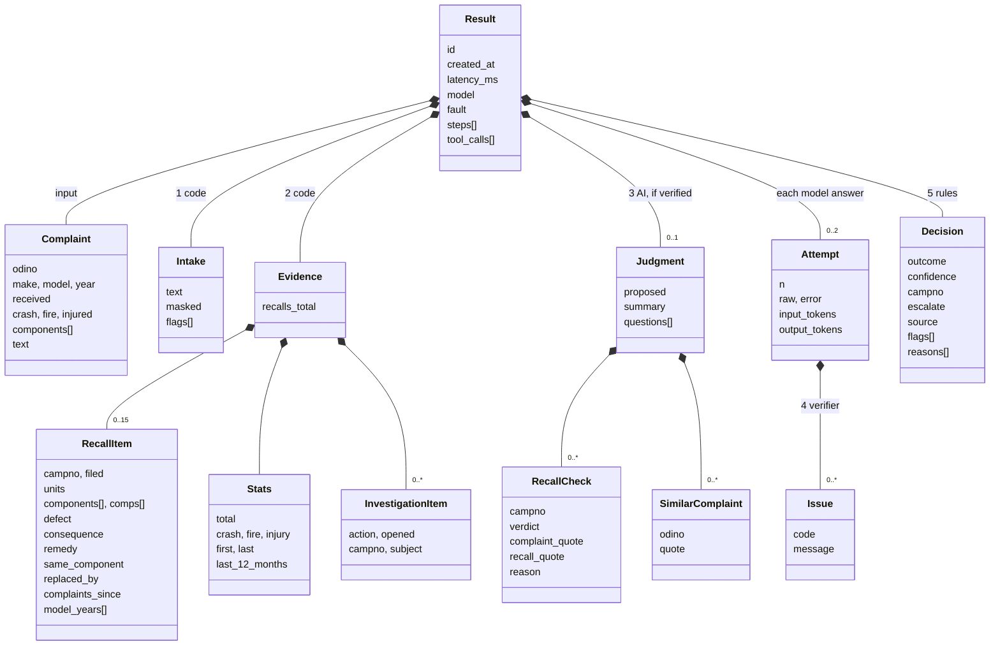

# Data model

Two SQLite files, kept apart on purpose:

| File | Written by | What it holds |
|---|---|---|
| `data/nhtsa.db` (~550 MB) | `python -m app.data.ingest`, once | NHTSA's public complaints, recalls and investigations. The app opens it **read-only**. |
| `data/app.db` | the app, at run time | Every AI run (the audit record) and what analysts do with tickets. |

There are no foreign-key constraints across the two files: `app.db` refers to NHTSA records by their public ids
(`odino` for a complaint, `campno` for a recall). Dashed lines below are such references or query-time joins; solid
lines are keys within one file. Samples of every table: `uv run python -m app.data.report` → `docs/data_report.html`
(section 3 and 5).

## nhtsa.db: what was known, and when

- **One row per complaint, recall or investigation**, plus one row per component (complaints: only the components of
  the complaint's own, first-named vehicle) or per covered make × model × year × component (recalls, investigations).
  Field meanings follow NHTSA's descriptions in `data/raw/CMPL.txt`, `RCL.txt`, `INV.txt`. Component names can contain commas, so grouping happens
  in Python, not with SQL `group_concat`.
- **The dashed joins are the core of the product.** A complaint's candidate recalls are the `recall_vehicles` rows with
  the same make, model and year whose recall was filed *strictly before* the complaint was received
  (`queries.recalls_for`). Every evidence query has that `as_of` rule; it lives only in `app/data/queries.py`.
- **Indexes:** `complaints(make, model, year, received)`, `complaint_components(odino)`,
  `recall_vehicles(make, model, year)` and `(campno)`, `investigation_vehicles(make, model, year)`.

## app.db: what the system did, and what people did with it

- **`results` is append-only**: every check (workspace, ops drill, evaluation) adds a row; the newest row per complaint
  and label is what the analyst sees. The listing columns are copies of fields in `body` so the ops portal can list
  runs without parsing JSON.
- **Values:** `results.source` is `ai_verified`, `ai_repaired`, `fallback` or `rules`; `tickets.status` is `waiting`,
  `resolved`, `escalated` or `monitoring` (no row = new); `actions.action` is `linked_recall`, `replied_to_owner`,
  `asked_owner`, `escalated`, `monitoring`, `closed` or `disagreed`.
- **People's work is separate from the AI's**: `tickets`, `issues`, `issue_complaints`, `actions` and `questions` are
  cleared by `python -m app.store.reset`; AI runs are kept. `actions` is an append-only log, including every
  "disagreed" with its reason: the feedback signal.

## results.body: one run, end to end

The `body` column holds a `Result` (`app/models.py`), in the order a complaint flows through the pipeline:

Everything an analyst or reviewer sees (the suggestion, the "how the agent investigated" trail, the ops audit page,
the evaluation scores) is computed from this one stored record, so it can be re-shown, re-scored with changed rules
(`app/eval/rescore.py`) or re-checked (`app/eval/trajectory.py`) without calling the model again.
